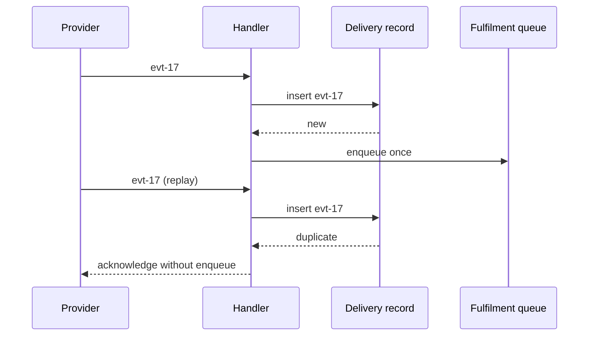

# Worked example: webhook replay protection

**Scope:** Method demonstration for FDE P8.4, not a replacement curriculum unit.
The scenario below is synthetic. The provider-contract boundary is owned by P4.8a;
delivery semantics and idempotency are owned by P8.4. Technical claims must use the
active journey's registered sources at lesson time.

## Part 1 — Curiosity, problem, prediction

**Hook:** A payment was captured twice, but the provider dashboard shows one event.
How can one event create two local effects?

**Synthetic scenario:** A webhook endpoint receives `delivery_id=evt-17`, times out
after writing an order update, and receives the same delivery again. The customer has
one charge but the local fulfilment queue has two jobs. The learner predicts which
boundary failed and what evidence to inspect before choosing a fix.

**Natural misconception:** “The provider sent two payments, so deduplicate by amount.”
The mentor asks what changes if two legitimate orders have the same amount.

## Part 2 — Discovery and concept formation

Start with the concrete distinction: a delivery can be repeated even when the business
event is one logical event. Form the concept of an idempotency key: a stable identity
that lets the receiver make a repeated operation produce one intended effect.

Progressive explanation:

1. Intuition: a receipt number, not a payment amount.
2. Example: `evt-17` maps to one recorded delivery outcome.
3. Mechanism: persist the identity and outcome under a uniqueness constraint.
4. Precision: the effect and acknowledgement must have a deliberate transaction
   boundary; “received” is not the same as “fully processed”.

**Analogy and limit:** A coat-check ticket helps find the same coat again. It does
not explain transaction isolation, ordering, or what happens when the worker crashes.

## Part 3 — Visual, reinforcement, boundary

Ask what changes if the first request crashes after the queue write, if deliveries
arrive out of order, or if the identity is retained for too short a period. Connect
the deeper transaction and queue guarantees to their owning units rather than solving
every future problem here.

## Part 4 — Return, retrieval, transfer

Return to the incident: inspect delivery IDs, transaction boundaries, uniqueness
errors, queue records, and provider contract evidence. The fix is not “deduplicate by
amount”; it is a documented identity and effect boundary that the system can verify.

**Immediate retrieval:** Explain why a repeated delivery is not proof of a repeated
business event.

**One practice task:** Design the receiver for an inventory-reservation webhook where
the provider may retry after a timeout and two different reservations can have the
same item count. State the identity, stored evidence, transaction boundary, and one
failure case that would falsify your design.
